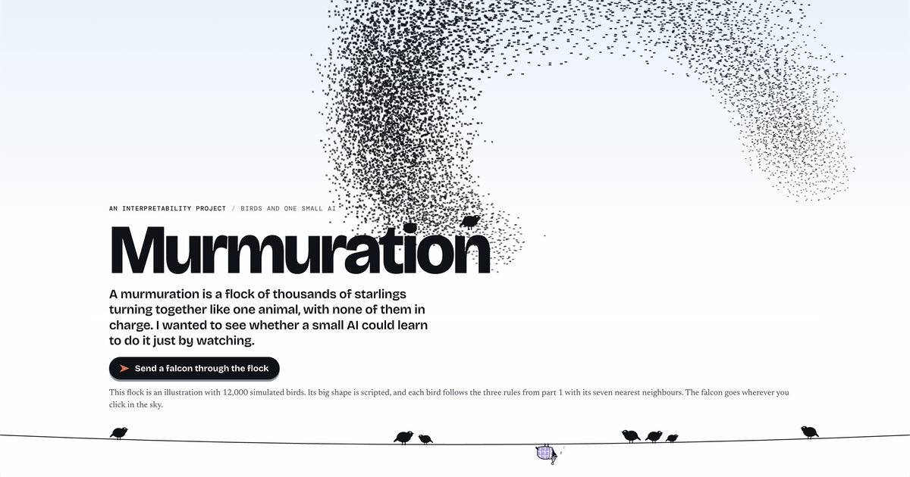

# Murmuration

[](https://kreptiliri.github.io/murmuration/)

A small transformer learns to fly a boids flock by watching, then I check where it keeps the three rules.

Website: https://kreptiliri.github.io/murmuration/

## Results

- It flies the flock. On 300 clips it never trained on, it predicts each bird's next move with R² 0.990 to 0.994 across 4 runs. It also flies 50 birds after training on 12.
- The rules are easy to read out of its notes, and some can be read before any training.
- Deafening round two removes line up in all 4 runs. The other two rules are split between the two rounds differently in each run.
- So finding a rule in the notes doesn't prove the machine uses it. Line up is readable after round one, but the machine only uses it in round two.

## What's in here

- `boids.py`: the simulator. 12 birds in a 100 x 100 world that wraps at the edges, three rules (separation, alignment, cohesion), speed limits, a cap on each rule's force and soft radius edges. It records every rule's push on every bird at every tick.
- `generate.py`: runs the simulator to build a dataset of clips and writes `config.json` with the physics and the git commit it came from.
- `windows.py`: cuts clips into training windows. The last two ticks go in and the next change in velocity comes out, plus each rule’s push on the same birds.
- `flocker.py`: the models. A transformer with one token per tick, one with one token per bird, and `RelPerBirdTransformer`, which every result uses. Its attention is told the offset and distance between each pair of birds.
- `train.py`: splits clips 70/30, scales the data, trains the chosen model, saves checkpoints and prints the held-out R².
- `probe.py`: fits a ridge regression on the model's notes (its hidden state after each round) to see how well each rule's push can be read from them, at every checkpoint.
- `ablate.py`: makes one round hear only its own bird and measures how much of each rule's push disappears from the answer, at every checkpoint.
- `rollout.py`: lets a saved model fly a flock on its own, each guess feeding the next tick.
- `plot_readability.py`, `plot_ablation.py`: plot the probe and ablation curves over training.
- `PHYSICS.md`: every simulator constant and what it does.
- `tests/`: the test suite.
- `docs/`: the website.

## Run it yourself

Python 3.14 with torch 2.14, numpy 2.5, matplotlib 3.11 and pytest 9.1. I trained everything on a laptop CPU (M4 MacBook Air).

```
python -m pytest -q
```

Generate the data: 1,000 clips of 500 ticks, about 200 MB. It refuses to run from a tree with uncommitted changes, because it records the commit.

```
python generate.py --clips 1000 --ticks 500 --out data/v2_big
```

Train one run. Each run took about 40 minutes. I ran seeds 0, 1, 2 and 3.

```
python train.py --data data/v2_big --clips 1000 --context 2 --model rel_per_bird --symmetries --passes 30 --seed 0 --log-checkpoints 8 --checkpoint-dir checkpoints/rel_v2_log_s0 --report-every 1
```

Probe and ablate every checkpoint of that run. The probe sweep took about 7 minutes and the ablation sweep about 4.

```
python probe.py --checkpoint-dir checkpoints/rel_v2_log_s0 --data data/v2_big --clips 1000 --sweep --out readability_s0.json
python ablate.py --checkpoint-dir checkpoints/rel_v2_log_s0 --data data/v2_big --clips 1000 --sweep --out ablation_s0.json
```

Plot them:

```
python plot_readability.py readability_s0.json --out readability_s0.png
python plot_ablation.py ablation_s0.json --readability readability_s0.json --out ablation_s0.png
```

The probe is fitted on clips 0-49 and scored on clips 700-719. The ablation is scored on clips 700-719.

Simulator details are in [PHYSICS.md](PHYSICS.md).

## License

MIT, see [LICENSE](LICENSE).
